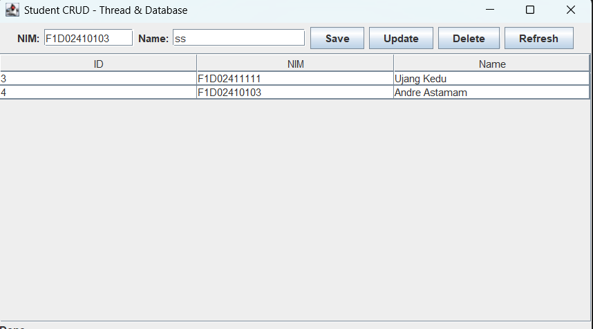

Latihan Java: Thread dan Database

Aplikasi CRUD data mahasiswa menggunakan Java Swing dan MySQL (JDBC). Proses database dijalankan di thread terpisah supaya tampilan aplikasi tidak macet, lalu hasilnya ditampilkan kembali ke GUI dengan aman.

NIM: <F1D02410103>
Nama: <Andre Astamam>
Mata Kuliah: Pemrograman Berorientasi Objek 

Isi Project
File	Fungsi
src/Database.java	Mengatur koneksi ke database MySQL
src/StudentDAO.java	Berisi semua proses CRUD ke database
src/MainFrame.java	Tampilan GUI, thread, dan penghubung ke DAO
lib/mysql-connector-j-26.10.0.jar	Driver JDBC agar Java bisa terhubung ke MySQL
database.sql	Script pembuatan database dan tabel
screenshots/	Kumpulan screenshot hasil program
Penjelasan Kode
1. Database.java (Koneksi)

Class ini hanya punya satu tugas, yaitu membuat koneksi ke MySQL. Di dalamnya tersimpan alamat server (localhost), port, nama database (campus_db), username, dan password. Class lain cukup memanggil method getConnection() setiap kali butuh koneksi, sehingga pengaturan koneksi tidak ditulis berulang-ulang dan mudah diubah di satu tempat.

2. StudentDAO.java (Data Access Object)

DAO adalah class khusus yang menangani semua urusan database, sehingga GUI tidak perlu tahu cara kerja SQL. Isinya ada empat operasi:

insert: menambah data mahasiswa baru. Proses ini memakai transaction: auto-commit dimatikan, data disimpan, lalu di-commit jika sukses. Jika terjadi error, data dibatalkan dengan rollback sehingga database tidak berisi data setengah jadi. Di dalamnya ada jeda 1 detik (Thread.sleep) hanya untuk simulasi proses lambat, agar tulisan "Saving..." sempat terlihat.
findAll: mengambil seluruh data mahasiswa. Hasil query dibaca baris demi baris menggunakan ResultSet, lalu dikumpulkan menjadi daftar untuk ditampilkan di tabel.
update: mengubah NIM dan nama mahasiswa berdasarkan ID.
delete: menghapus data mahasiswa berdasarkan ID.

Semua query memakai PreparedStatement, yaitu SQL dengan tanda tanya sebagai tempat nilai yang diisi belakangan. Cara ini lebih aman dari SQL injection dan lebih rapi daripada menyambung string SQL secara manual. Koneksi, statement, dan result set ditutup otomatis memakai try-with-resources.

3. MainFrame.java (GUI, Thread, dan invokeLater)

Class ini membuat jendela aplikasi: dua kolom input (NIM dan Nama), empat tombol, tabel data, dan label status di bagian bawah. Saat sebuah baris tabel diklik, isinya otomatis muncul di kolom input agar mudah diedit.

Bagian terpenting ada pada method runDb, yang menerapkan pola yang diminta dosen dengan urutan berikut:

Saat tombol diklik, semua tombol dinonaktifkan supaya pengguna tidak menekan dua kali.
Label status diubah menjadi teks proses, misalnya "Saving...".
Pekerjaan database dijalankan di thread baru. Jika dijalankan langsung di thread GUI, jendela akan membeku selama proses berlangsung.
Setelah selesai, hasilnya (berhasil atau pesan error) dikirim kembali ke GUI lewat SwingUtilities.invokeLater. Ini wajib karena komponen Swing hanya boleh diubah dari Event Dispatch Thread.
Di dalam invokeLater, label diubah menjadi "Done", tombol diaktifkan kembali, dan tabel dimuat ulang.

Method loadTable bekerja dengan pola yang sama: data dibaca dari database di thread terpisah, lalu tabel diperbarui lewat invokeLater.

Cara Menjalankan
Jalankan Laragon, lalu klik Start All sampai MySQL aktif.
Buka HeidiSQL, lalu jalankan isi database.sql untuk membuat database campus_db dan tabel students.
Di VS Code, buka Java Projects > Referenced Libraries, klik tanda +, lalu pilih file JAR di folder lib.
Periksa pengaturan di Database.java, terutama port MySQL, username, dan password. Sesuaikan dengan pengaturan Laragon kamu.
Jalankan MainFrame.java.
Struktur Tabel

Tabel students di database campus_db memiliki tiga kolom:

id: bilangan bulat, primary key, bertambah otomatis
nim: teks maksimal 20 karakter, wajib diisi
name: teks maksimal 100 karakter, wajib diisi
Screenshot
Tampilan aplikasi

